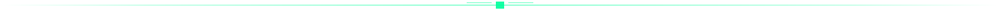
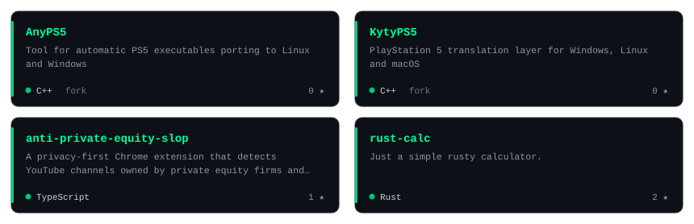
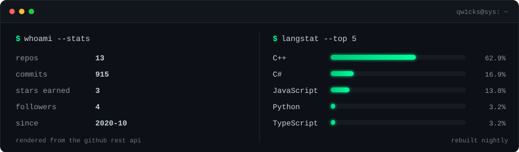
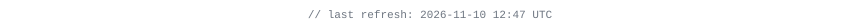

<div align="center">


<a href="https://github.com/QW1CKS"></a>

<br/>


<a href="https://x.com/QW1CKS"></a>

<br/><br/>

<sub><a href="#whoami">whoami</a>&nbsp;·&nbsp;<a href="#work">work</a>&nbsp;·&nbsp;<a href="#stack">stack</a>&nbsp;·&nbsp;<a href="#signal">signal</a></sub>

</div>



### whoami

```console
root@qw1cks:~$ whoami
avionics engineer — communications, networks, RF.
same paranoia, new attack surface: backends, system libraries,
compilers, and anything with a locked bootloader.

root@qw1cks:~$ cat /etc/interests.conf
systems     rust · c++ · libc internals · abis · loaders
compilers   parsers · ir · codegen · linkers
security    reverse engineering · exploit dev · privilege escalation
backend     services · cloud · networking · infra

root@qw1cks:~$ ls -1 ~/work
AnyPS5/
KytyPS5/
anti-private-equity-slop/
rust-calc/

root@qw1cks:~$ _
```


### work

**[AnyPS5](https://github.com/QW1CKS/AnyPS5) / [KytyPS5](https://github.com/QW1CKS/KytyPS5)**
— PlayStation 5 translation layers for Linux, Windows and macOS.
Currently deep in libc internals: `std::num_put` exports, ABI-correct stubs, and
import-resolution tables. The interesting part is that nothing tells you where the
boundary is — you find it by crashing into it.

**[anti-private-equity-slop](https://github.com/QW1CKS/anti-private-equity-slop)** —
privacy-first Chrome extension that flags YouTube channels owned by private equity
firms. Detection runs entirely client-side; nothing leaves the tab.

**[rust-calc](https://github.com/QW1CKS/rust-calc)** — a small, honest parser and
evaluator. Where I go to remember that compilers are just data structures, and that
shipping beats perfect.

<a href="https://github.com/QW1CKS?tab=repositories"></a>

**Next up** — a toy compiler (lexer → IR → x86-64) and kernel module experiments.
Everything else lives in the [repositories tab](https://github.com/QW1CKS?tab=repositories).


### stack

<div align="center">


<br/>


</div>


### signal

<div align="center">




<br/><br/>

<picture>
  <source media="(prefers-color-scheme: dark)" srcset="https://raw.githubusercontent.com/QW1CKS/QW1CKS/output/github-snake-dark.svg" />
  
</picture>

<br/><br/>

<picture>
  <source media="(prefers-color-scheme: dark)" srcset="https://raw.githubusercontent.com/QW1CKS/QW1CKS/main/profile-3d-contrib/profile-night-green.svg" />
  
</picture>

</div>


<div align="center">

<sub><i>there is no cloud — it's just someone else's computer, and i'd like root on it.</i></sub>

<br/><br/>



<sub>cards rendered from the github api · rebuilt nightly by actions</sub>

</div>
